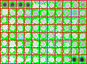

# ELISA array image analysis

`elisa_grid_quantification.py` measures the dark signal in each cell of an ELISA array image carrying a **manually drawn red grid**. It supports the Chapter 4 ELISA image quantification workflow and preserves the calculation in the original `calculating.py`.

The grid must be drawn before analysis. The script locates the existing red lines; it does not draw a grid, detect spots, crop an image, or align an array.

## Files

| File | Purpose |
| --- | --- |
| `elisa_grid_quantification.py` | Analysis script, based on the original calculation |
| `requirements.txt` | Python dependencies |
| `examples/D_grid_example.png` | Original uploaded `D_grid.png`, renamed; file bytes are preserved |
| `examples/D_grid_example.tif` | Original uploaded `D_grid.tif`, renamed; decoded RGB pixels match the PNG |
| `example_results/D_grid_example_classified.png` | Pixel classification produced from the example PNG |
| `example_results/D_grid_example_signals.csv` | Results for all 88 cells, in row order |
| `example_results/D_grid_example_signals.xlsx` | Results plus an 8-by-11 signal-mean sheet |
| `example_results/D_grid_example_analysis.json` | Parameters, input/script checksums, and software versions |

## Install and run

Use Python 3.10 or later. Open a terminal in this folder and install the dependencies.

```bash
python -m pip install -r requirements.txt
```

Run the bundled example.

```bash
python elisa_grid_quantification.py
```

This reads `examples/D_grid_example.png` relative to the script and writes four files into `elisa_results/` in the terminal's current directory. No preview window opens by default.

For another manually gridded image, specify its path.

```bash
python elisa_grid_quantification.py "path/to/sample_grid.png" --output-dir sample_results
```

The TIFF example can be run separately.

```bash
python elisa_grid_quantification.py examples/D_grid_example.tif --output-dir elisa_results_tif
```

To change array dimensions or display a preview, use these options.

```bash
python elisa_grid_quantification.py sample_grid.png --rows 8 --cols 11 --preview
```

Existing output files with the same names are overwritten. Use a separate output directory to retain another run.

## Prepare the input manually

1. Crop and orient the array so that rows and columns occupy the full image, with little surrounding margin. Rows are labeled A onward from top to bottom; columns are labeled 1 onward from left to right. The defaults are 8 rows and 11 columns.
2. Draw straight red lines between cells and along all four outer edges. Place the lines between spots. Use solid red, such as RGB `(255, 0, 0)`. The detection rule is `R > 180`, `G < 80`, and `B < 80`.
3. Save an 8-bit color PNG or TIFF. Retain the original resolution and pixel values within the cells. An ungridded cropped image is not an analysis input.
4. Check that each lower-left 2-by-2-pixel background patch lies in a suitable background region. The script uses this location in every cell, as in the original calculation.

The initial center of each cell is estimated from equal subdivisions of the image width and height. The script scans upward, downward, leftward, and rightward until it reaches the manually drawn red lines. Accordingly, the crop and spacing must place each expected center inside its intended cell.

Missing boundaries, centers on grid lines, repeated cell bounds, red pixels inside a measurement region, and cells too small for the background patch cause an error. Correct the grid manually and run again. These checks validate the grid geometry; the user must inspect spot placement and background suitability.

## Calculation

The default calculation preserves the original script's numerical rules.

1. Convert the color image to OpenCV grayscale and invert it as `I = 255 - grayscale`. Darker pixels therefore have higher values on the 0-255 scale.
2. Use the red lines to determine each rectangular measurement region. The surrounding red lines are outside the region.
3. Calculate background `B` as the mean inverted grayscale of the lower-left 2-by-2 pixels.
4. Calculate upper reference `U` as the mean of the 10 highest inverted grayscale values in the region. This step includes the background patch, matching the original script. If there are fewer than 10 pixels, use all region pixels.
5. Set the threshold to `T = B + 0.30 * (U - B)`.
6. Exclude the four background pixels from classification and measurement. Color pixels with `I <= B` sky blue. Color pixels with `B < I < T` green. Retain pixels with `I > B` and `I >= T` as signal.
7. Report `signal_mean` as the mean inverted grayscale of the retained signal pixels. If none remain, report 0 and `signal_pixels = 0`.

`signal_mean` is a mean pixel intensity. It is not an integrated intensity, and background is used to set thresholds without being subtracted from the reported mean. The script does not perform control normalization, replicate averaging, cytokine identification, or statistical comparisons.

The original background size, upper-reference count, and threshold fraction can be changed with `--bg-size`, `--top-n`, and `--threshold-fraction`. The equivalent names `--background-patch`, `--top-pixels`, and `--signal-fraction` are also accepted. The chosen values are recorded in the JSON output. Use consistent settings when comparing images.

## Outputs

The output prefix is the input filename without its extension. For `D_grid_example.png`, the files are `D_grid_example_classified.png`, `D_grid_example_signals.csv`, `D_grid_example_signals.xlsx`, and `D_grid_example_analysis.json`.

| Result column | Meaning |
| --- | --- |
| `well` | Grid cell, such as A1 or H11 |
| `bg_threshold` | Background mean `B` |
| `green_threshold` | Threshold `T` |
| `signal_mean` | Mean retained inverted grayscale; 0 if no pixels are retained |
| `signal_pixels` | Number of retained signal pixels |
| `total_pixels` | Number of measurement-region pixels after excluding the background patch |
| `top_pixels_mean` | Upper reference `U` |
| `x1`, `y1` | Zero-based left and top coordinates of the measurement region |
| `x2_exclusive`, `y2_exclusive` | Right and bottom coordinates excluded from the region |

The first six columns match the original script. The coordinate columns describe the Python slice `image[y1:y2_exclusive, x1:x2_exclusive]`. Pixel intensities are on an 8-bit grayscale scale; pixel counts are counts, not physical areas.

The workbook contains a `signals` sheet with all result columns and a `signal_mean` sheet arranged by grid row and column. The classified image leaves retained signal pixels, background patches, and red grid lines unchanged. Review it before using the numerical results.



## Example validation

The supplied PNG and TIFF both contain 146-by-108-pixel images with identical decoded RGB values. Each produces 88 measurements, from A1 through H11. The default results were checked against the original `calculating.py`; all six original result columns and every classified-image pixel agree exactly. The generated classified image also agrees exactly with the uploaded `D_grid_classified.png` reference.

The example records cell positions only. Map these positions to the experimental array layout before assigning protein identities or combining replicates. The lower-left four-pixel background estimate and local threshold remain the assumptions of the original method.
